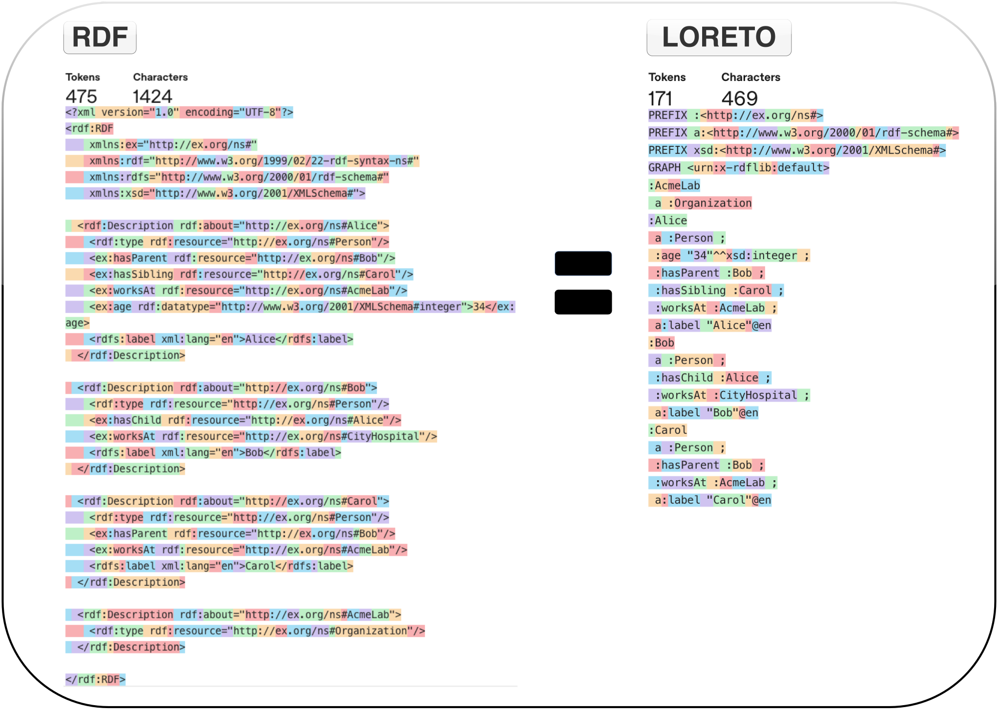

# Loreto

Loreto stands for **Logic Ontology Representation Tokenization Optimisation**.

Loreto is a compact textual serialisation for RDF/OWL datasets, designed to reduce token
consumption when ontological content is placed in LLM prompts. It preserves the RDF dataset
(it is lossless and comes with a parser and a round-trip check), and it keeps a readable,
Turtle-like graph layout.



This repository contains the three parts of the paper *Loreto: Token-Efficient RDF/OWL
Serialisation for LLM Prompts* (The Web Conference 2027, demo track):

- **Loreto**, the serialiser: [`loreto.py`](loreto.py), a single Python file with a command-line
  tool and an API, its format specification ([`docs/format.md`](docs/format.md)), examples and
  tests. The rest of this README is about it.
- **Loreto Playground**, the web demo: [`playground/`](playground). It shows the token cost of an
  RDF document in each format, where the tokens go and what each transformation saves. A public
  instance runs at https://khaos.uma.es/loreto/, and it runs locally with
  `docker compose up` (see [`playground/README.md`](playground/README.md)).
- **The experiments of the paper**: [`experiments/`](experiments). The token study over 87
  BioPortal ontologies (Table 1), the sanity check on LLM-KG-Bench, and the scripts that make
  the figures (see [`experiments/README.md`](experiments/README.md)).


## Why Loreto

Standard RDF serialisations such as RDF/XML, Turtle, N-Triples, TriG and JSON-LD are designed
for interoperability, not for the tokenisers of large language models. A format that is
compact in characters is not necessarily compact in tokens.

Loreto makes every representation choice by measuring the result with the tokeniser of the
target model:

- which namespaces get a prefix, including OBO identifier spaces (`GO:0008150`);
- which alias each prefix gets. A conventional name (`owl:`, `foaf:`) is used whenever it
  costs no more than an arbitrary letter, and the alias `a` is never used because it would
  clash with `a` = `rdf:type`;
- which repeated IRIs without a prefix go to a small dictionary;
- whether a flat or a subject-grouped layout is cheaper.

It also uses the compact notations of Turtle: `a`, `[ … ]` for blank nodes, `( … )` for RDF
lists, and bare numbers and booleans.


## Quick start

```bash
python3 -m venv .venv
source .venv/bin/activate
pip install -r requirements.txt
```

Convert an ontology, check the round trip and print statistics:

```bash
python3 loreto.py input.owl                      # writes input.loreto and input.normalized.ttl
python3 loreto.py input.ttl --no-ttl --verify     # exit code 2 if the round trip fails
python3 loreto.py input.rdf -o output.loreto --tokenizer cl100k_base --stats-json stats.json
python3 loreto.py output.loreto                  # decode: writes output.decoded.ttl (or .trig)
```

From Python:

```python
import loreto
from rdflib import Graph

g = Graph().parse("input.ttl")
text = loreto.serialize(g)                        # optimised for o200k_base
text, stats = loreto.serialize(g, tokenizer="/models/Qwen3-8B/tokenizer.json", return_stats=True)
assert loreto.verify(g, text)                     # parse(text) is isomorphic to g
dataset = loreto.parse(text)                      # rdflib Dataset
```

`serialize` accepts an rdflib `Graph` or `Dataset` (named graphs are kept), or an iterable of
`(s, p, o)` triples or `(g, s, p, o)` quads.


## What it looks like

Turtle (`examples/swrl/rules.ttl`):

```turtle
ex:rule1 a swrl:Imp ;
  swrl:body ( [ a swrl:ClassAtom ; swrl:classPredicate ex:Person ; swrl:argument1 ex:x ] ) ;
  swrl:head ( [ a swrl:ClassAtom ; swrl:classPredicate ex:Agent ; swrl:argument1 ex:x ] ) .
ex:x a swrl:Variable .
ex:Person a owl:Class .
ex:Agent a owl:Class .
```

Loreto (`examples/swrl/rules.loreto`, 124 `o200k_base` tokens):

```text
PREFIX :<http://www.w3.org/2003/11/swrl#>
PREFIX ex:<http://example.org/>
PREFIX owl:<http://www.w3.org/2002/07/owl#>
ex:Agent
 a owl:Class
ex:Person
 a owl:Class
ex:rule1
 a :Imp ;
 :body ( [ a :ClassAtom ; :argument1 ex:x ; :classPredicate ex:Person ] ) ;
 :head ( [ a :ClassAtom ; :argument1 ex:x ; :classPredicate ex:Agent ] )
ex:x
 a :Variable
```

[`docs/format.md`](docs/format.md) gives the grammar, the semantics, how the text is chosen
and the exact guarantees.


## Tokenisers: use the one of your model

Loreto minimises the token count of *your* model. Choose its tokeniser with `--tokenizer`
(command line) or `tokenizer=` (Python):

| Value | Tokeniser | Network |
|---|---|---|
| `o200k_base` (default) | OpenAI GPT-4o and later (tiktoken) | no, once tiktoken has its file |
| `cl100k_base` | OpenAI GPT-4 / GPT-3.5 (tiktoken) | no, once tiktoken has its file |
| `tiktoken:<model>` | the tiktoken encoding of an OpenAI model name, e.g. `tiktoken:gpt-4o` | no, once tiktoken has its file |
| `path/to/tokenizer.json` | **any open model**: the Hugging Face tokenizer file (Llama, Qwen, DeepSeek, Mistral, Gemma, Phi…) | no |
| `hf:<repo-id>` | downloads `tokenizer.json` from the Hugging Face Hub, e.g. `hf:Qwen/Qwen3-8B` | yes |
| `bytes`, `chars` | UTF-8 bytes or characters | no |

For an open model, the recommended option is the path to its `tokenizer.json`:

- It is the standard file of Hugging Face models. It sits in the folder of every model you
  have downloaded or serve locally (e.g. with vLLM), and it can be downloaded once from the
  model's page. Gated models (Llama, Gemma) need that one download with your account.
- It works offline, it only reads data (no code is executed), and it is reproducible: citing
  the file is enough to obtain the same token counts.
- It needs `pip install tokenizers`.

```bash
python3 loreto.py ontology.owl --tokenizer /models/Qwen3-8B/tokenizer.json
python3 loreto.py ontology.owl --tokenizer ~/tokenizers/llama-3.1/tokenizer.json --verify
```

```python
text = loreto.serialize(g, tokenizer="/models/Qwen3-8B/tokenizer.json")
```

Any other tokeniser can be plugged in from Python. Pass an object with a `count(text) -> int`
method and a `name` attribute:

```python
class MyTokenizer:
    name = "my-model"
    def count(self, text):
        return len(my_tokenizer.encode(text))

text = loreto.serialize(g, counter=MyTokenizer())
```

Closed models (Claude, Gemini) do not publish their tokenisers, and counting through their
APIs would take thousands of calls. Use the tokeniser of a similar model instead. In our
corpus, text optimised for `o200k_base` costs at most 0.03% more tokens with the Qwen3,
DeepSeek-V3 and Llama 3.1 tokenisers than text optimised for each of them.

A missing backend or a missing file is an error: Loreto never falls back silently to
another cost function.


## Ablations

Each transformation can be switched off: `--layout flat|grouped`, `--aliases short|mnemonic`,
`--no-prefixes`, `--no-id-prefixes`, `--no-dict`, `--no-lists`, `--no-literal-shorthand` and
`--no-inline`, or the same fields of `loreto.LoretoOptions`. `--legend` prepends a one-line
`#` description of the syntax, for prompts where the model has not seen Loreto before.
`--deskolemize` turns skolem IRIs (`/.well-known/genid/`, as used by BioPortal) back into
blank nodes.


## Guarantees and tests

- **Lossless.** `parse(serialize(D))` is isomorphic to the RDF dataset `D` (`"x"` and
  `"x"^^xsd:string` are the same literal in RDF 1.1). The writer also checks that it emitted
  every triple.
- **Deterministic.** The output does not depend on the order of the input triples or on
  blank node identifiers.
- `python -m pytest tests -q` runs these checks:
  - round trips of the examples and of random datasets under every combination of options;
  - regressions for lists, blank-node cycles and blank nodes shared between named graphs;
  - determinism under shuffled input;
  - alias restrictions and literal edge cases;
  - the command-line interface.


## Corpus benchmark

[`experiments/corpus/benchmark_corpus.py`](experiments/corpus/benchmark_corpus.py) measures
every ontology in a folder with each tokeniser, in the standard formats and in each Loreto
variant. It records tokens, bytes and serialisation time, and optionally round-trip
verification:

```bash
python3 experiments/corpus/benchmark_corpus.py --root path/to/ontologies --glob "**/*.owl" \
    --tokenizers o200k_base,cl100k_base --verify --out results/
```

The results for the BioPortal corpus of the paper, the list of its ontologies and Table 1 are in
[`experiments/corpus/`](experiments/corpus).


## Repository contents

```text
Loreto/
├── loreto.py                  converter, parser, verifier and CLI (single file)
├── requirements.txt
├── docs/format.md             format specification
├── examples/                  basic RDF, OWL and SWRL inputs with their Loreto output
├── tests/test_loreto.py
├── playground/                Loreto Playground: web demo (FastAPI + static page, Docker)
└── experiments/
    ├── corpus/                token study over the BioPortal corpus (Table 1)
    ├── llm-kg-bench/          sanity check on LLM-KG-Bench: scores and prompt lengths
    └── figures/               scripts for Figures 1 and 2 of the paper
```
